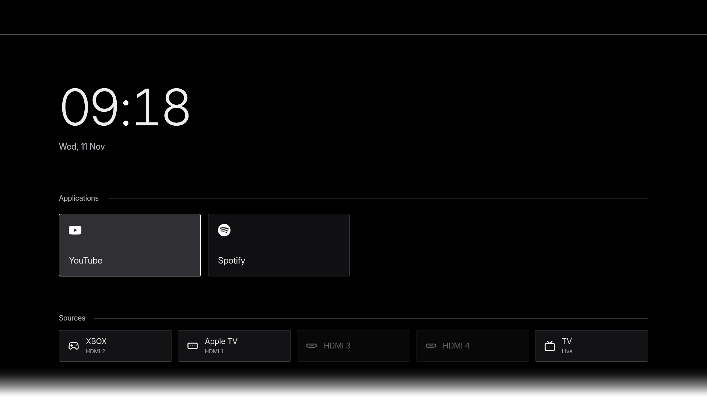

# qtizen

**A minimal, customizable home screen for Samsung Tizen TVs.**

qtizen brings your applications and HDMI sources together on one screen. It runs
on the TV itself and gives you control over the layout, colours, backgrounds and
widgets, with a simple interface designed for the remote.



_Captured directly from a Samsung S95F at 1920×1080, with widgets turned off._

## Make Home your own

- **Applications and sources.** Keep the apps you use on Home, arrange them in a
  grid or a scrolling row, adjust card sizes and rename your HDMI sources.
- **Light and dark themes.** Choose an accent that colours the whole interface.
  Dark mode uses a true-black background and restrained decoration for OLED screens.
- **Backgrounds and widgets.** Use solid colours, animated backgrounds or weather
  photos. Add a Solar System or Moon widget, or leave the space empty.
- **Time, weather and Continue Watching.** Choose what appears on your screen and
  configure supported Continue Watching providers in Settings.
- **Home on your remote.** On compatible TVs, use qtizen as the destination for
  the Home button and at startup.

The launcher also requests suppression of Samsung's app-loading overlay. Actual
behaviour depends on the TV firmware; applications can still show their own loading screens.

## Do I need root?

**The launcher can be installed and used without root.** You need Developer Mode
and a Samsung account to sign the app. Home-button and startup integration
have model-specific requirements; see the [Home setup guide](docs/home-pc-flow.md).

The optional [root helper](docs/root-cli.md) adds:

- **App transitions:** choose None, Fade or Samsung's standard transition.
- **HDMI-CEC wake:** wake a sleeping device when selecting its source, tested with Apple TV.

Root setup is separate from installing the launcher. Automatic root reacquisition
after a full power disconnect is not yet verified on the S95F used for development.

## Status and compatibility

qtizen is under active development. **There are no prebuilt qtizen releases yet**;
installation currently requires building from source using the steps below.

Developed and tested on **Samsung QE65S95FAUXCE (S95F), Tizen 9, firmware 1301.0**,
including Home return, app launches, transition choices and Apple TV wake.
Other models and firmware versions need their own validation. The
[compatibility guide](docs/tv-compatibility.md) distinguishes qtizen tests from earlier
community reports.

qtizen customizes the home screen and does not replace the TV firmware.
Samsung's OLED panel-maintenance routines remain in place.

## Build and install

You need Python 3.10+, Node.js 22.12+ (or 20.19+), the .NET 6 SDK for native helpers,
a Samsung account, and a computer on the same network as the TV.

```sh
git clone https://github.com/butukay/qtizen.git
cd qtizen
python3 -m venv .venv
source .venv/bin/activate
python -m pip install -e '.[dev]'
npm ci
python cli/tools/build_home_query.py
python cli/tools/build_home_control.py
python cli/tools/build_root_runtime.py
npm run build
```

On Windows, activate the environment with `.venv\Scripts\Activate.ps1` in PowerShell.

1. On the TV, open **Apps**, enter **12345**, enable Developer Mode and set Host PC IP
   to your computer's local IP. Disconnect TV / One Connect power for 60 seconds,
   reconnect and turn it on.
2. Replace `TV_IP` below with the TV's address. Complete Samsung sign-in when the
   certificate command opens your browser. Keep the signing profile for future updates.

```sh
qtizen --tv TV_IP status
qtizen --tv TV_IP certs
qtizen --tv TV_IP install ./dist/launcher
```

3. Open **qtizen** from the TV's Apps screen. For the remote's Home button and startup,
   follow the [Native Home backup and setup guide](docs/home-pc-flow.md).

For an existing installation, follow the [migration and update guide](docs/manage-installation.md).

## Development

```sh
npm run dev -- --host 0.0.0.0
```

See [CONTRIBUTING.md](CONTRIBUTING.md) for the development setup, tests and project
structure. For a [bug or TV compatibility report](https://github.com/butukay/qtizen/issues/new/choose),
include the exact model, firmware and observed behaviour.

## Guides

- [Interface and customization](docs/default-interface.md)
- [Widgets and Continue Watching](docs/launcher.md)
- [Updates, migration and removal](docs/manage-installation.md)
- [Home button, startup and recovery](docs/home-pc-flow.md)
- [Optional root features](docs/root-cli.md)
- [Diagnostics](docs/diagnostics.md)
- [Samsung privacy settings](docs/settings.md) and [optional DNS lists](dns/)

## Credits and license

qtizen is maintained by [butukay](https://github.com/butukay) and builds on
[AeroTizen](https://github.com/helalaou/AeroTizen), originally created by Hamza El Alaoui.
The original history, authorship and MIT notices are preserved. Root acquisition
uses [samsung-tv-root](https://github.com/chris-ritsen/samsung-tv-root).
See [CREDITS.md](CREDITS.md) for original contributors and dependencies, and
[LICENSE](LICENSE) for the MIT license.

### qtizen contributors

<!-- contributors:start -->
<table>
  <tr>
    <td align="center"><a href="https://github.com/butukay"><br><sub>butukay</sub></a></td>
  </tr>
</table>
<!-- contributors:end -->

This project is not affiliated with Samsung or Apple. Application artwork and
trademarks belong to their respective owners.
