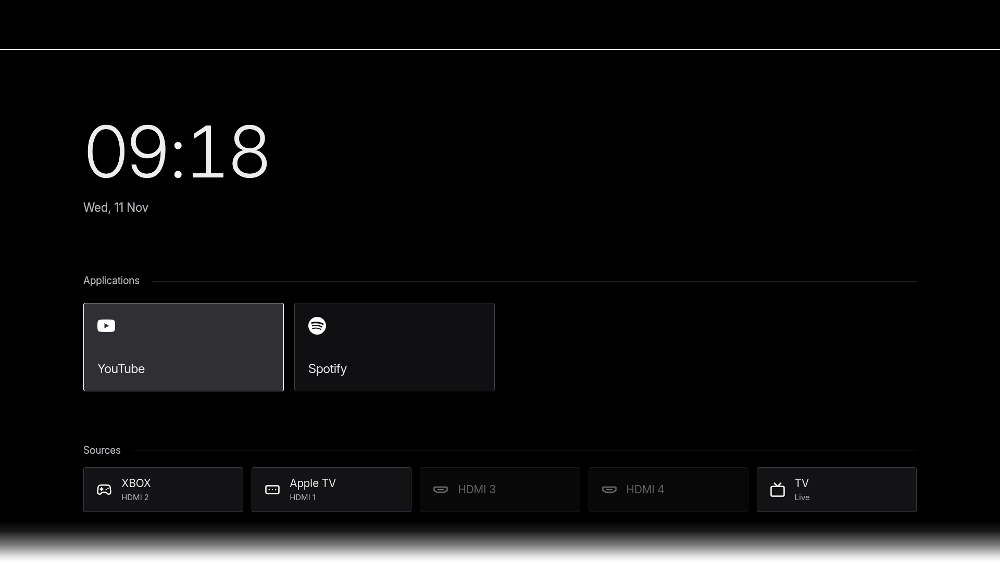

# Default interface

This personal fork has one interface with Light and Dark appearance modes.
The old Classic, Glass and optional Nord interfaces are no longer shipped.

_Browser preview with sample apps and inputs, not a capture from a TV._

The screen uses true black, flat blue-grey cards, a thin cyan focus outline and
Inter typography. Settings is hidden at the top right until remote focus reaches it. Press Up from
the first content row to reveal the gear, then OK to open it. Closing Settings
restores the last content selection and hides the gear again. Time and
date sit beside a quiet Solar System. Applications and Sources share a label and
thin separator; neither shows an item count. The television source reads TV
with a muted Live subtitle. At 1920×1080 the Solar System occupies 760×355 pixels;
app cards are 184, 170 or 156 pixels tall for three, four or five columns.

Favorites are managed in Settings → Applications or with the long-press app menu.
Grid and horizontal scrolling, app sizes, HDMI names, time/date visibility,
language and numerals remain configurable. Existing favorites and input names
survive migration. Old theme and clock-layout preferences are discarded once;
old theme profiles start on black without weather photos. New wallpaper choices
continue to use the shared wallpaper service.

Widgets offers Solar System, Moon phase and Off. The Solar System is a static
schematic with eight muted planet dots and thin orbits. Moon phase uses the
[US Naval Observatory's reference new moon](https://aa.usno.navy.mil/api/moon/phases/year?year=2026)
and a mean lunar cycle to estimate the illuminated shape from the TV clock.

The launcher has no inactivity dimming and does not consume a wake key. While
visible it requests `SCREEN_SAVER_OFF` through Samsung's
[AppCommon API](https://developer.samsung.com/smarttv/develop/guides/fundamentals/setting-screensaver.html).
Playback-start events repeat the request after the media pipeline is ready.
Tizen plays a local silent H.264 loop with a transparent video element while the
launcher is visible, including when Widgets is set to Off. The loop pauses while
an embedded TV input is opening or playing. Hiding or disposing the app restores
`SCREEN_SAVER_ON`. The local SDK loads inside the Tizen widget.

Run `npm run dev` and open `http://localhost:8019/` for a browser preview.
Fonts and their SIL Open Font Licenses are bundled in `launcher/assets/fonts/`.
Install updates with the existing signing profile and keep the `DclHome001.Home`
identity so the TV's Home and startup assignments remain valid.

Settings uses this order: Appearance, Backgrounds, Widgets, Applications, Weather, Inputs,
Language and About. Appearance starts with Light/Dark and Accent. Default is the
first accent and uses white in Dark mode and black in Light mode. App layout,
time/date controls and Performance mode follow. Background choices start with
Solid colors and end with Weather photos. Applications and Continue Watching
providers use full-width rows with compact logos and inline selection marks. The
sidebar footer has no remote-button help. Existing app IDs, saved favorites and
input names are unchanged.

Each palette colours the application cards, input rows, Settings surfaces, text and
focus marks. The black canvas, selected wallpaper and solar media keep their own
appearance. Press towards the Settings sidebar to leave any row that has no further
choice in that direction, including the controls in Weather.
