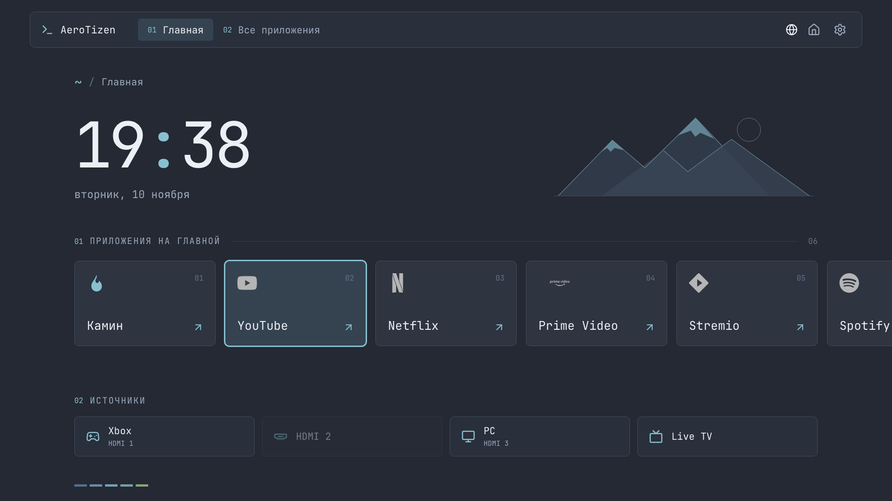

# Nord rice

This fork adds **Nord** under **Settings → Appearance → Interface appearance**.
Classic and Glass remain available. Nord is opt-in and survives launcher updates
and restarts through the existing preference store.

*Browser preview with sample apps and inputs, not a capture from a TV.*

Nord uses a true-black background, flat blue-grey surfaces and a thin cyan
remote focus. Cards have small corners and no gradients or shadows. The header
has no brand label or workspace numbers. English labels use Applications,
Favorites and TV. Inter provides the main typography; JetBrains Mono stays on small
workspace and section details. The existing clock, apps and HDMI positions are
preserved. Grid and horizontal scrolling, app sizes, favourites and the app actions
menu still work. Clock and date visibility, time format, language and numerals
follow the existing preferences.

The Solar System is a quiet schematic: a small Sun, eight muted planet dots,
fine orbital lines and a single Saturn ring. There are no image textures, lighting
or glow effects. Display sizes and distances are compressed to fit the scene.
Initial phases and video speeds are composed for legibility and a seamless loop,
rather than current sky positions or a physical scale.

The moving scene is a bundled, silent 600×280 H.264 video. It uses the same flat
artwork as the SVG fallback and loops after 120 seconds. It pauses when Home is
inactive, in Performance mode and with reduced motion enabled. The fallback stays
visible until playback starts, and returns if decoding fails. No remote video,
texture download or JavaScript render loop runs on the TV.

Regenerate the bundled artwork with `node tools/render-solar-loop.mjs`; this
optional offline tool requires FFmpeg and the project's Playwright Chromium.

The launcher does not dim or blank itself after inactivity, and does not consume
a wake key. While Nord is visible, it requests `SCREEN_SAVER_OFF` through Samsung's
[AppCommon API](https://developer.samsung.com/smarttv/develop/guides/fundamentals/setting-screensaver.html).
Playback-start events repeat this request after the media pipeline is ready.
Hiding the app, choosing another theme or disposing the launcher restores
`SCREEN_SAVER_ON`. The Samsung SDK loads locally on Tizen only. Unsupported APIs
leave the launcher usable; OLED firmware may still enforce its own protection.
Pixel Shift, logo brightness and Pixel Refresh settings are unchanged. API request
tests do not establish whether a particular TV suppresses its native saver.

On the QE65S95FAUXCE with firmware 1301, AppCommon alone did not suppress the
OLED dot saver even when called after full load. A live comparison with the
solar video playing kept Home visible for more than four minutes, confirmed on
the TV by its owner. This observation does not establish behavior on other TVs.

The saved wallpaper and weather-photo preferences are preserved. Nord temporarily
uses its own static wallpaper and suspends weather photos; switching to Classic or
Glass restores the selected wallpaper. Native HDMI playback retains a transparent
page for its video surface.

For a browser preview, start `npm run dev` and open
`http://localhost:8019/?appearance=nord`. This uses a separate browser-only preference
profile and does not change the normal preview profile or a TV's preferences.

Fonts are bundled in `launcher/assets/fonts/`, including their complete SIL Open
Font Licenses.

For physical testing, build the launcher and update the existing package using the
same Samsung signing profile. Keep the `DclHome001.Home` app ID so the existing Home
and startup assignments continue to point to the launcher. Select Nord in Appearance.
Native Home and the root helper are not changed by this appearance feature.
